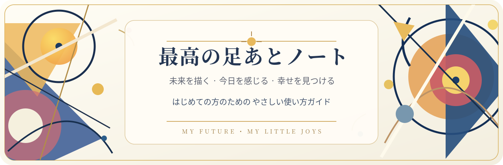

# 🌷 最高の足あとノート

**未来を描き、今日を感じる。自分の言葉で育てる、小さな幸せの記録帳。**

[アプリを開く](https://meme-max-code.github.io/meme-oracle/note.html)

> **ご案内：このREADMEは「完全版」に向けた制作中のガイドです。** ここで紹介するカレンダー、朝晩の新しいワーク、名前変更などは、現行版ではまだ使えない場合があります。完成版の動作を確認してから、この案内を公開用に更新します。

## 🌼 このノートについて

「最高の足あとノート」は、超意識やマインドフルネスを学ぶ人が、**自分の意識の向け方を見つめ、日々の小さな幸せや気づきを記録する**ためのノートです。

大きな夢を描く日も、コーヒーがおいしかったことに感謝する日も、どちらも大切。正解も、ノルマもありません。**1つだけでも、何も書かない日があっても大丈夫**です。

## ✨ はじめて使うときは

1. アプリを開き、好きな**名前やニックネーム**を設定します（完全版で追加予定）。
2. **「最高の未来」**に、心が明るくなる未来の姿を書きます。初めは短いひとことでも大丈夫です。
3. **「いつも意識していたい言葉」**を1つ選びます。ホームを開くと目に入るようにします（完全版で追加予定）。
4. あとはその日の気分で、**朝のワーク**か**夜のワーク**を開いてみましょう。

最初から全部埋める必要はありません。書きたいところから始めてください。

## ☀️ 朝のワーク — 今日の私に小さな種をまく

| 項目 | 何を書く？ | たとえば |
| --- | --- | --- |
| **私のささやかな願い** | 今日あったらうれしい、小さな願い | 「おいしいコーヒーが飲めますように」 |
| **感謝ワーク** | 今、ありがたいと感じること | 「今朝も気持ちよく起きられた」 |
| **設定ワーク** | 今日どうありたいか、どんな一日にしたいか | 「落ち着いた気持ちで過ごす」 |
| **褒めワーク** | 自分を認めたいこと | 「朝から一つ片づけられた。よくやった」 |

**書く数は自由です。** 1つ追加するたびに自動で番号がつく仕組みを予定しています。10個書く必要はありません。

## 🌙 夜のワーク — 今日の贈りものを受け取る

**① ささやかな願いの振り返り**  
朝につぶやいた願いを読み返します。「叶った、ありがとう」「これからのお楽しみ」など、無理なく振り返りましょう。

**② 私が今日受け取ったもの**  
人からの優しさ、言葉、助け、出会い、豊かな時間など。形のあるものでも、ないものでも大丈夫です。

**③ 今日の気づき**  
瞑想中や日常の中で、ふと受け取ったと感じる直感、イメージ、見えない世界からのメッセージのように感じたことを、自分の言葉で残す場所です。意味を急いで決めなくても大丈夫。

**④ 今日の感謝・褒め**  
夜になって浮かんだことを、朝の記録に追加できます。

**⑤ 叶った感謝の儀式**  
最高の未来を読み返し、「叶いました。ありがとう」と感謝するひとときを持ちます。言葉は自分らしいものに変更できる予定です。

## 🌟 最高の未来を描く

ホームの上のほうには、いつでも目に入る**「〇〇の最高の未来」**を表示します。もう少し具体的に描きたいときは、次のページを開きます。

**10年後／5年後／1年後／6ヶ月後／3ヶ月後／1ヶ月後**

毎日書き直す必要はありません。思い描く未来が変わったときに、自由に書き換えられます。

## 📖 足あと日記 — あとから、ゆっくり読み返す

完全版では、カレンダーから日付をタップすると、その日の**朝と夜の記録が、一冊の日記のように**読めるようになる予定です。

入力は気軽な箇条書き。読み返すときは、**自分の言葉を勝手に書き換えず**、朝から夜へ自然に並ぶ形にします。最後には、何でも書ける**「今日のひとこと」**も。

たとえば何ヶ月か後に「この日はこんな小さな幸せがあった」と見返す楽しみが増えます。

## 🎙 iPhoneで声を使って書くには

1. ワークの入力欄をタップします。
2. iPhoneのキーボードにある**マイクのマーク**をタップします。
3. 話した内容が文字になったら、内容を確認して追加・保存します。

※ iPhoneの音声入力設定や使用するキーボードによって表示・操作が異なります。誤変換があった場合は、あとから文字を編集できるようにします。

## 📱 ホーム画面に置くには

iPhoneで **Safari** を開き、[アプリのページ](https://meme-max-code.github.io/meme-oracle/note.html) を表示します。Safariの**共有（四角から上向き矢印）**を押し、**「ホーム画面に追加」**を選ぶと、アプリのようなアイコンから開けます。

普段Braveをお使いの方も、この追加操作はSafariから行うとわかりやすいです。

## 🧡 記録を大切に守るために

現行版の記録は、基本的に**使っているブラウザ内**に保存されます。ブラウザを変えたり、端末を買い替えたりすると、記録が自動では引き継がれない場合があります。

現行版には**記録を書き出す（バックアップ）／記録を復元する**機能があります。大切な記録は、ときどきバックアップファイルとして保存してください。

**ご注意：** 復元操作は、その端末にある記録をバックアップの内容で**置き換える**ことがあります。復元前にも現在の記録をバックアップしておくと安心です。完全版の保存方式については、完成時にあらためて案内します。

## 🌈 このノートで大切にしたいこと

「書かなきゃ」ではなく、「書きたい」ときに開くこと。  
「できなかった」ではなく、「今日できたこと」に目を向けること。  
大きな未来と、目の前の小さな喜びの両方を大切にすること。

**あなたの一日が、そのまま、あなたの大切な足あとになります。**

---

*Design concept: カンディンスキー風の抽象幾何学 × 優しいアイボリー × 読みやすい余白。© meme atelier*

<!-- 完全版リリース担当者向け: 実装状況を確認した後、冒頭の「制作中」注記と「予定」の表現を更新すること。音声入力・バックアップ・復元・名前変更・未来固定表示・カレンダー・ワーク保存の実機検証を行うこと。既存のlocalStorageデータとJSONバックアップの互換性を維持し、公開前に復元テストを行うこと。 -->
