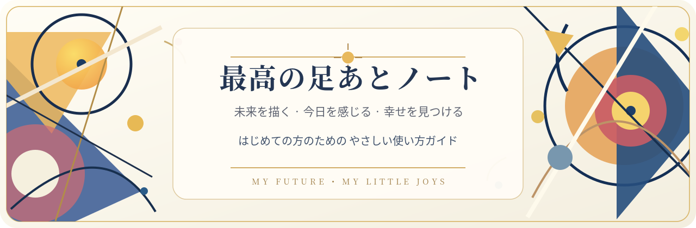

# 最高の足あとノート

未来を描き、今日を感じる。朝晩のワークを、自分の言葉で育てるノートです。

[アプリを開く](https://meme-max-code.github.io/meme-oracle/note.html)

## 使い方

1. 設定から、名前・いつも意識していたい言葉・儀式の言葉を保存します。
2. 未来の設定から、最高の未来と10年後〜1ヶ月後の未来を描きます。
3. 朝は、ささやかな願い・感謝・設定・褒めのワークを。夜は願いの振り返り、受け取ったもの、直感や気づき、感謝と褒めの追加、感謝の儀式を。
4. カレンダーから日付を選ぶと、その日の記録を読めます。今日のひとことも自由に書けます。

数のノルマはありません。入力途中も下書き保存し、登録後の編集・削除もできます。

## iPhone

Safariで開き、共有→「ホーム画面に追加」でアプリのように使えます。音声入力はiPhoneキーボードのマイクから。誤変換を確認してから追加・保存してください。通信のない場所での起動は保証しません。

## 大切な記録

データは利用者ごとの端末・ブラウザに保存します。公開ソースに日記データは含みません。利用者間の共有・クラウド同期はありません。

「設定」→「全記録をファイルに保存」でJSONバックアップを保管してください。機種変更時は新端末の「バックアップから追加・復元する」へ。現在の記録を消さずに統合します。異なる言葉は両方保管します。

旧版の保存キーは書き換えません。同じドメイン・同じブラウザの旧記録を読み込み、完全版の別キーへ保存します。別ブラウザ・別端末・Macの確認版からはJSONで移してください。

[保存と引き継ぎの詳細](DATA-SAFETY.md) ／ [確認状況](VALIDATION.md) ／ [制作時の元README](README-original.md)

## 公開用構成

note.html にアプリのCSS・JavaScript・画面アートをまとめています。ホーム画面用の footsteps-icon.png と footsteps.webmanifest を同じ場所に配置してください。保存ロジックは制作版と共通です。index.html のオラクルカードは維持します。

iPhone実機での音声入力・ホーム画面追加は、利用者の端末で最終確認してください。

© meme atelier
